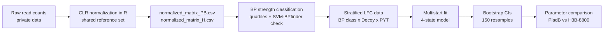

# Modeling SF3B1 Recruitment Kinetics: Branch Point vs. Decoy Competition under Antitumoral Treatment

Code and analysis for my Master's thesis in Quantitative and Computational Biosciences, University of Padova (A.Y. 2025/2026).

**Author:** Marco De Gennaro
**Supervisor:** Prof.ssa Chiara Romualdi (University of Padova)
**Co-supervisor:** Dr. Rosa Martinez-Corral (UPF)

> **Note on data:** the experimental data used in this project are private and are **not included** in this repository. The code can be read and reviewed as it is, but the full pipeline can only be re-run with the data files. See the [Data](#data) section.

---

## Overview

SF3B1 is a core protein of the spliceosome. During pre-mRNA splicing it must find the correct **branch point (BP)**, but similar "wrong" sites nearby (**decoys**) compete for it. Splicing inhibitors such as **Pladienolide B (PladB)** and **H3B-8800** block the conformational change SF3B1 needs to lock onto the BP. No existing kinetic model described site competition and drug inhibition together.

This project builds that model and tests it on in vitro assembly data from a mutagenesis library.

What the code does:

1. **Normalizes the sequencing data in R.** Read counts are compositional, so I use a Centered Log-Ratio (CLR) approach with a reference set of stable sequences.
2. **Classifies branch points by strength** (Strong / Intermediate / Weak) using empirical read quartiles, checked against SVM-BPfinder scores.
3. **Models SF3B1 binding as a four-state graph.** Steady-state occupancies are solved exactly with the Matrix-Tree Theorem.
4. **Fits the model to both drugs** with multistart L-BFGS-B, then estimates confidence intervals with a non-parametric bootstrap.
5. **Checks whether the fitted parameters make biological sense.**

## Main results

- Good global fit: weighted R² of **0.84** (PladB) and **0.85** (H3B-8800).
- Some parameters do **not** match biological expectations. For example, the strength scalers do not always separate the strength classes. The thesis treats this as a diagnostic result (possible non-identifiability or a model that is too simple). See Chapter 3.4 and the Conclusions.

This repository is the code behind that analysis. It is not a finished model of SF3B1.

## Pipeline



## The model in short

| Code | State | Meaning |
|---|---|---|
| `P1` | Free RNA | no SF3B1 attached |
| `P2` | BP open | SF3B1 on the branch point, weak and reversible |
| `P3` | Decoy | SF3B1 stuck on the non-productive site |
| `P4` | BP closed | SF3B1 locked on the branch point (functional) |

Rates: `k1`/`k_1` (free ⇄ BP), `k2`/`k_2` (free ⇄ decoy), `k3` (open → closed), `k4` (closed → free). The drug slows the open → closed step (`k3`). `model_database.py` lists all candidate models.

The observed quantity is the log2 fold change (LFC) vs. control. The model predicts it from `P_bound = P2 + P3 + P4`.

## Repository structure

```
sf3b1-recruitment-kinetics/
├── README.md
├── requirements.txt
├── data/
│   └── README.md          # describes the expected data files (data not included)
├── R/
│   └── Compositional_Normalization_Correction.R
├── src/
│   ├── data_prep.py
│   ├── model_database.py
│   ├── parameter_function.py
│   ├── simulation_core.py
│   ├── fitting_core.py
│   └── visualization_functions.py
├── notebooks/
│   ├── 01_BP_strength_classification.ipynb
│   ├── 02_Best_Model_Prediction.ipynb
│   └── 03_Parameter_Estimation_and_Analysis.ipynb
└── docs/
    └── thesis.pdf
```

The modules in `src/` are imported by name (`import model_database as db`), so they are kept flat. The first cell of each notebook adds `../src` to the path.

## What each file does

| File | Purpose |
|---|---|
| `R/Compositional_Normalization_Correction.R` | CLR-based normalization. Finds sequences that are stable across conditions in both drug series and uses them as the reference. Writes `normalized_matrix_PB.csv` and `normalized_matrix_H.csv`. |
| `src/data_prep.py` | Loads and merges the data, filters low-count sequences, computes LFC, extracts the BP, assigns BP classes and splits the data by BP class × Decoy × PYT. |
| `src/model_database.py` | Catalogue of 11 candidate models (3 or 4 states) and the drug modulation functions. |
| `src/parameter_function.py` | Generates parameter sets under the biological constraints used in the thesis. |
| `src/simulation_core.py` | Builds the graph and computes steady-state probabilities (Matrix-Tree Theorem). |
| `src/fitting_core.py` | Weighted least-squares objective, multistart fit, bootstrap, goodness-of-fit and thesis plots. |
| `src/visualization_functions.py` | Plot helpers for raw simulations (single model, side by side, grid, 2D robustness map). |
| `notebooks/01_...` | BP strength classification and validation with SVM-BPfinder. |
| `notebooks/02_...` | Model selection and fits for PladB and H3B-8800. |
| `notebooks/03_...` | Bootstrap, parameter comparison between drugs, identifiability checks. |

The notebooks are saved with their outputs, so you can read the results and plots without running anything.

## Data

The data are **private** and are not part of this repository. This covers the raw read counts and every file derived from them (normalized matrices, LFC tables, SVM-BPfinder input and output).

The code expects these files:

| File | Origin |
|---|---|
| `fitness_calc_PB_H3B.xlsx` | Raw read counts from the in vitro assembly experiment (provided by the lab). |
| `normalized_matrix_PB.csv`, `normalized_matrix_H.csv` | Output of the R script. |
| `log_reads_norm.csv`, `lfc_results.csv` | Earlier normalization, kept for the comparison in Figures 6 to 8 of the thesis. |
| SVM-BPfinder files | Input `.fasta` and output `.txt` from the external tool. |

If you need access to the data, please contact me. See `data/README.md` for the expected columns and file locations.

## What you can check without the data

- The model definition and the steady-state solution (`model_database.py`, `simulation_core.py`). With a parameter set, you can simulate the model without any experimental data.
- The fitting logic and the objective function (`fitting_core.py`).
- The results and plots saved in the notebook outputs.
- The full methods and results in the thesis (`docs/thesis.pdf`).

## Requirements

- Python 3.10 or newer (thesis used 3.12)
- R 4.x (thesis used 4.4.2) with `readxl`, `zCompositions`, `matrixStats`, `tidyverse`
- SVM-BPfinder, only if you want to redo the BP validation

## Quick start (with access to the data)

```bash
# 1. Clone
git clone https://github.com/<your-username>/sf3b1-recruitment-kinetics.git
cd sf3b1-recruitment-kinetics

# 2. Python environment
python -m venv .venv
source .venv/bin/activate        # Windows: .venv\Scripts\activate
pip install -r requirements.txt
```

```r
# 3. R packages (once)
install.packages(c("readxl", "zCompositions", "matrixStats", "tidyverse"))
```

4. Put the data files in a local folder (for example `data/raw/` and `data/processed/`). Do not commit them. Update the path variables at the top of the R script and of each notebook.

```bash
# 5. Normalization (run from the folder where the output should go)
cd data/processed
Rscript ../../R/Compositional_Normalization_Correction.R
cd ../..

# 6. Notebooks
jupyter lab
```

Run the notebooks in this order:

1. `01_BP_strength_classification.ipynb`
2. `02_Best_Model_Prediction.ipynb`
3. `03_Parameter_Estimation_and_Analysis.ipynb`

Optional, to redo the SVM-BPfinder step:

```bash
python3 svm_bpfinder.py -i test_sequence_Strong_PYT.fasta -s Hsap -l 100 -d 10 > BP_results_Strong_PYT.txt
```

Expected result: weighted R² of about 0.84 (PladB) and 0.85 (H3B-8800).

## Reproducibility notes

- Random starts and bootstrap resamples use `numpy.random.default_rng` with fixed seeds (bootstrap seed: `1149`).
- The bootstrap is the slowest step. For a quick test, lower `n_bootstrap_runs` and `n_starts` in notebook 03.

## Citation

> De Gennaro, M. (2026). *Modeling SF3B1 Recruitment Kinetics: Branch Point vs. Decoy Competition under Antitumoral Treatment.* Master's thesis, University of Padova.
